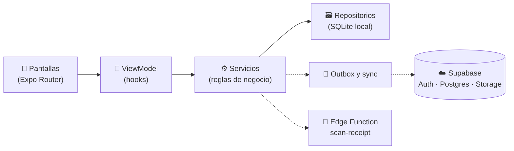

<div align="center">

# 👛 Bolsillo

**Anota un gasto en 5 segundos. Fotografía una factura y olvídate de teclearla.**

Una app móvil para llevar tus finanzas personales con calma: rápida, privada y que funciona sin conexión.


</div>

---

## ✨ ¿Qué es Bolsillo?

La mayoría de la gente anota sus gastos en notas sueltas o directamente no los anota, y a fin de mes no sabe a dónde se fue el dinero. Bolsillo ataca el problema de raíz: **reducir el esfuerzo de cada registro**, porque eso es lo que sostiene el hábito.

Está pensada para estudiantes, jóvenes y freelancers que quieren control sin hojas de cálculo ni conexiones bancarias.

## 🎯 Qué podrás hacer

|                                 |                                                                                          |
| ------------------------------- | ---------------------------------------------------------------------------------------- |
| ⚡ **Captura rápida**           | Monto, categoría y listo: un gasto guardado en menos de 5 segundos.                      |
| 🧾 **Escaneo de facturas**      | Haz una foto y Bolsillo extrae comercio, fecha, total e impuestos. Tú revisas y guardas. |
| 🗂️ **Categorías a tu medida**   | Predefinidas y personalizadas, para gastos y para ingresos.                              |
| 📊 **Resumen visual**           | Mira en qué se va el dinero por categoría, semana o mes.                                 |
| 🎚️ **Presupuestos con alertas** | Fija un límite mensual por categoría y recibe un aviso al 80 % y al 100 %.               |
| 🔁 **Gastos recurrentes**       | Suscripciones y pagos periódicos que se registran solos, con recordatorio previo.        |
| 📴 **Sin conexión**             | Todo funciona offline; los escaneos pendientes se procesan cuando vuelve la red.         |
| ☁️ **Respaldo opcional**        | Cuenta opcional para sincronizar entre dispositivos. Tus datos, tu decisión.             |
| 🌗 **Tema claro y oscuro**      | Con contraste verificado (WCAG 4.5:1) en ambos modos.                                    |

> **Lo que Bolsillo no hace, a propósito:** conectarse a tu banco, mover dinero real, ni darte asesoría financiera.

## 🧱 Cómo está construida



- **Arquitectura por funcionalidades con MVVM.** Cada feature (`capture`, `transactions`, `categories`, `budgets`, `reports`, `recurring`, `receipt-scan`, `settings`, `account`) tiene sus capas `ui`, `model`, `service` y `data`, y solo se comunica con las demás a través de su `index.ts`.
- **Offline-first.** SQLite es la fuente de verdad en el dispositivo; la sincronización con Supabase usa un _outbox_ y es opcional.
- **Dinero sin decimales.** Todos los importes son enteros en la unidad menor de la moneda; nada de `float`.
- **Seguridad por diseño.** Cada tabla de Postgres tiene RLS, el bucket de facturas es privado y la clave del modelo de visión vive solo en la Edge Function, nunca en la app.

### Stack

| Capa                | Tecnología                                                     |
| ------------------- | -------------------------------------------------------------- |
| App                 | React Native · Expo SDK 58 · Expo Router · TypeScript estricto |
| Datos locales       | `expo-sqlite` con migraciones versionadas                      |
| Backend             | Supabase: Auth, Postgres con RLS, Storage y Edge Functions     |
| Lectura de facturas | Modelo de visión de Claude, invocado desde una Edge Function   |
| Calidad             | Jest (`jest-expo`) · ESLint · Prettier · Maestro (e2e)         |

## 📁 Estructura

```text
bolsillo/
├── app/                  # Rutas de Expo Router (solo componen pantallas)
├── src/
│   ├── features/<x>/     # ui · model · service · data
│   ├── db/               # Cliente SQLite y migraciones
│   ├── sync/             # Outbox y sincronización
│   ├── ui/               # Tema y componentes compartidos
│   └── core/             # Dinero, fechas, errores, logger, cadenas
├── supabase/
│   ├── migrations/       # Esquema Postgres, RLS, bucket y cupo de escaneos
│   └── functions/        # Edge Function scan-receipt
├── __tests__/            # Pruebas unitarias y de componentes
└── e2e/                  # Flujos Maestro
```

## 🚀 Empezar

**Requisitos:** Node.js 24 (o 22.13 o superior; las pruebas usan `node:sqlite`), un móvil con [Expo Go](https://expo.dev/go) o un emulador, y (opcional, para el backend local) Docker y la CLI de Supabase.

```bash
git clone https://github.com/wilrd14/bolsillo.git
cd bolsillo
npm install
npx expo start
```

Para el backend, copia las plantillas de entorno y rellénalas con tus propios valores:

```bash
cp .env.example .env
cp supabase/.env.example supabase/.env
```

> 🔐 Los archivos `.env` están en `.gitignore`. No subas nunca claves reales al repositorio.

### Backend local con Supabase

```bash
supabase start      # levanta Postgres, Auth y Storage en Docker
supabase db reset   # aplica las migraciones desde cero
```

## 🧪 Comandos

| Comando             | Qué hace                                      |
| ------------------- | --------------------------------------------- |
| `npm start`         | Servidor de desarrollo de Expo                |
| `npm test`          | Pruebas con Jest                              |
| `npm run lint`      | ESLint y comprobación de formato con Prettier |
| `npm run typecheck` | Verificación de tipos con TypeScript          |
| `npm run build`     | Typecheck y exportación de la app             |

## 🗺️ Estado del proyecto

Bolsillo está **en desarrollo activo**.

- [x] Esqueleto de la app, tooling y estructura por funcionalidades
- [x] Núcleo compartido: dinero, fechas, errores y cadenas
- [x] Base SQLite local, migraciones y repositorios
- [x] Tema claro/oscuro, componentes base y navegación por pestañas
- [x] Esquema Postgres con RLS y bucket privado
- [ ] Captura rápida, lista de movimientos y categorías
- [ ] Presupuestos, alertas y gastos recurrentes
- [ ] Resumen visual
- [ ] Escaneo de facturas
- [ ] Cuenta y sincronización
- [ ] Accesibilidad, pruebas e2e y publicación

## 🤝 Cómo se desarrolla

El proyecto se construye con un flujo orquestado: un orquestador planifica y revisa cada tarea, y distintos agentes de IA la implementan bajo reglas de arquitectura y calidad estrictas. Cada tarea se verifica con pruebas, lint y tipos antes de aprobarse y subirse a `main`.

## 📄 Licencia

Distribuido bajo la licencia **GNU GPL v3.0**. Consulta el archivo [LICENSE](LICENSE) para más información.

<div align="center">

Hecho con cariño para que llevar las cuentas deje de dar pereza. 👛

</div>
